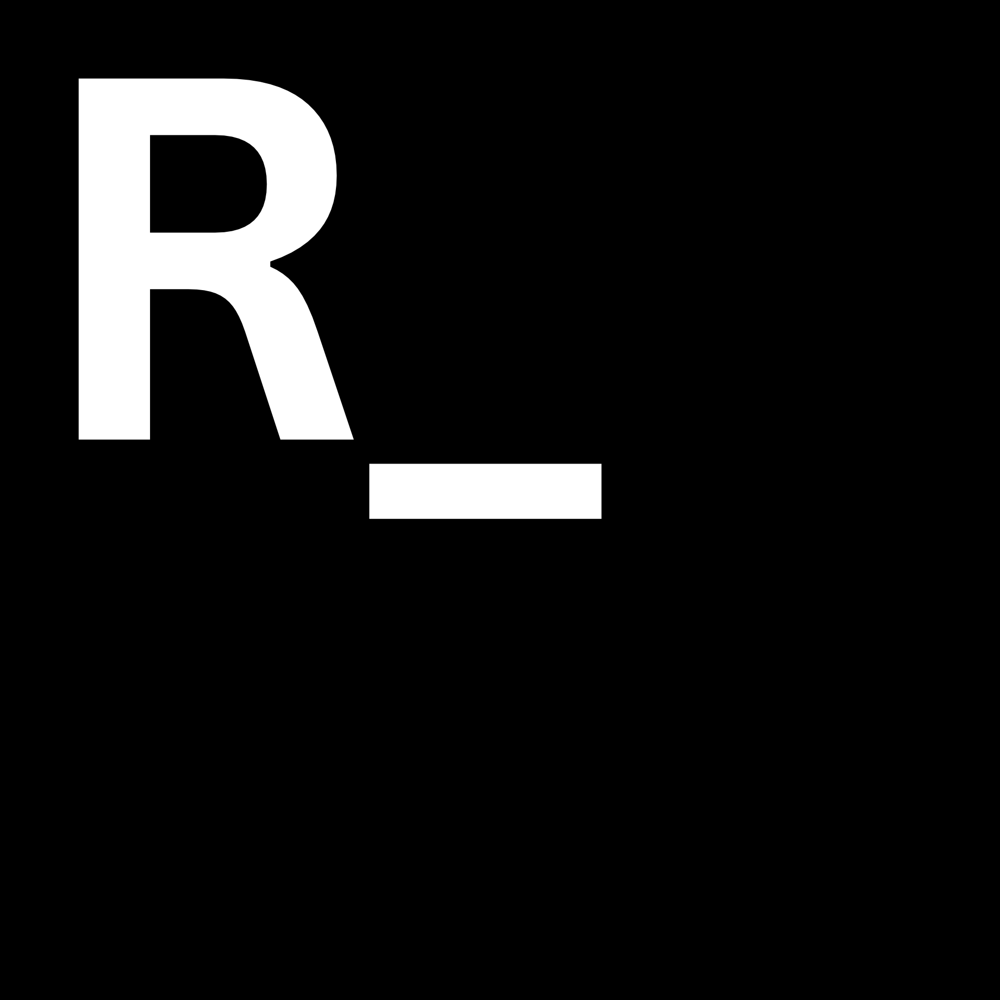

# RuTerm

<p align="center">
  
</p>

**RuTerm is an open-source SSH workspace for the desktop.** Hosts, identities,
keys and terminal preferences live in a single JSON document that stays readable
on your own machine, secrets are sealed locally, and — if you want it — the whole
vault syncs through a **credential-encrypted bridge** you control. MIT licensed, no
subscription, no account server, no vendor holding your credentials.

A Termius-class workflow, built in the open.

> Status: active development (v0.1.0). The macOS build works daily. Windows and
> Linux builds are not packaged yet.

---

## Features

### Sessions and tabs

- Native SSH (**russh**, Rust) with PTY sessions streamed into **xterm.js** —
  real terminals, not emulated panes.
- One tab per session; drag tabs to reorder; split any session into two panes
  (left/right/top/bottom); pin, duplicate, or close from the tab's context menu.
- **Reload-proof, restart-proof sessions.** Cmd+R or a crash re-attaches each tab
  to its live backend session — nothing reconnects. Restarting the app restores
  the whole layout (tab order, splits, active tab per pane), replays your last
  scrollback, reconnects SSH tabs automatically, respawns local shells in the
  same directory, and restores quick-connect and note tabs. Scrollback never
  leaves your machine and is never synced; clear it any time in
  Settings → Sessions.
- Per-tab connection status, automatic OS detection on connect, and
  trust-on-first-use host-key pinning with fingerprint shown and stored.
- Tab right-click menu: split, duplicate, close — plus page tabs for Settings
  and the host editor.

### Files (SFTP)

- Built-in file manager over the same SSH muscle as the terminal — no separate
  tool, no extra ports. Open it from the sidebar host row (folder icon), from
  the Home screen's recent hosts, or from a live session's right-click tab
  menu → **Files (SFTP)**.
- Browse any directory (breadcrumb path bar, directories first, size, modified
  time, `rwxr-xr-x` permissions), create folders, rename and delete — deletion
  understands directory trees and always asks first.
- **Upload** via a native picker (multi-select) or by dropping files straight
  from Finder onto the list. **Download** with a native Save dialog. No
  settings, no sync of the remote listing: the panel is a live view.
- **Open files in a real editor.** Text files load in Monaco (the VS Code
  engine) with syntax highlighting for HTML, CSS, JS/TS, PHP, Python, Go, Rust,
  JSON, YAML, SQL, shell and more — plus minimap, multi-cursor (Option-click or
  ⌘D), bracket-pair guides, find & replace and folding. The editor follows the
  app's Dark/Light theme and is loaded lazily, so startup is unaffected.
- **Image preview.** PNG, JPEG, GIF, WebP, AVIF, BMP, ICO and SVG open as an
  image in the tab (up to 12 MB) instead of the old binary placeholder.
- **Hidden files, hidden by default.** An eye toggle in the toolbar reveals
  dotfiles; the status bar shows how many are hidden, and a folder with only
  hidden items offers a one-click reveal.
- **Saves that survive picky servers.** Writes go through a temp file and an
  atomic rename; when a server refuses to rename over an existing file, the
  panel falls back to overwriting in place (preserving permission bits) instead
  of failing.
- Saved hosts use the vault credentials you already have. Quick-connect targets
  use your SSH agent — passwords are never stored, so password-only
  quick-connect SFTP is not offered.

### The vault

- One document — `vault.json` — holds hosts, groups, identities, snippets,
  port forwards, **notes** and settings. It's plain JSON: readable, diffable,
  backup-able.
- **Field-level encryption.** Passwords and private keys are sealed with
  XChaCha20-Poly1305 (Argon2id-derived key); everything else stays readable.
- **Notes** (free-form Markdown) live in the same document and open as full
  tabs in the UI. Notes are readable JSON, so sync metadata stays visible to
  the bridge operator.
- Atomic writes (tmp → fsync → rename) with the previous file kept as
  `vault.json.bak`; stale temp and backup files are cleaned on reset.
- The vault key is cached in the OS keychain so reopening the app doesn't ask
  for the passphrase every launch. The legacy `12345678` fallback only unlocks
  a local vault once, then re-seals it with the current context.
- Cross-device merge is last-write-wins per entity with tombstones, so
  deletions stay deleted after a sync. Every sync document now carries a
  key-derived HMAC: unsigned or tampered copies are rejected before merge.
  Update every device before syncing — older clients cannot read signed
  documents, and current builds reject unsigned legacy ones.
- Reset is local-only: it unlinks sync and removes the local backup, but leaves
  the remote copy untouched until you explicitly re-adopt it.

### Sync (optional)

- Sign in with Google (one Desktop OAuth client, PKCE, system browser). The
  one client secret Google requires lives in the bridge, never in the app.
- Sync goes through a **credential-encrypted bridge** (Cloudflare Worker + D1).
  Credential fields are sealed client-side; host labels, addresses, usernames,
  notes, tags and settings remain readable metadata on the server. The operator
  cannot read sealed credentials, but can read that metadata.
- The local vault is bound to the Google account that adopted it, and sign-out
  performs a full local wipe (key, plaintext vault, tokens, chat state and live
  sessions) rather than only dropping the token.
- Deploy your own bridge (`bridge/`) in one command, or try the experimental
  hosted instance at `sync.lagitest.xyz`.
- New device? Point it at the bridge, sign in, enter the same vault passphrase —
  the vault is adopted and decrypted locally. The legacy passphrase is never
  used for remote adopt or sync.
- Sign-in is a real identity: RuTerm shows your **Google profile photo, display
  name and Google account ID** in Settings → Google and sync, and the sidebar
  footer shows your photo + name. The bridge stores and returns the avatar —
  it persists across sign-out/in cycles.
- **Honest sync status**: a green check when this device matches the cloud, a
  red X when local changes haven't been pushed, plus the time of the last
  successful sync ("Last synced 5 minutes ago") — persisted across restarts.
- Prefer no cloud at all? RuTerm is fully usable offline with nothing but the
  JSON file.

### AI chat and coding agents

- Optional BYOK chat against OpenRouter: enter your own key in Settings → AI,
  then use the `< >` button in the sidebar dock. A one-click link opens
  `https://openrouter.ai/keys`. The raw key is sealed in the vault and never
  returned to the webview; **Test connection** still verifies with
  `Connected — AI replied: Hello World!`.
- Risky commands are denied by default. Notes, snippets and host notes need
  explicit approval before the assistant can read them, and approvals happen in
  a native dialog — injected page code cannot answer its own prompt. Credential
  reads can never be “always allowed”; scoped approvals expire with the reply.
- Chat bubbles are redacted before `localStorage` and the history is cleared on
  lock, sign-out and account change.
- One-click, zero-config MCP launch for installed agents (OpenCode, Claude,
  Kiro, Kilo Code, Command AI and friends). The loopback token lives in a
  Rust-owned 0600 config file, never in webview state; the bridge validates
  `Host`/`Origin` and sends restrictive headers.

### Security posture

- Strict Content Security Policy is enabled (inline styles only, so themes
  still render), `withGlobalTauri` is off, and the main window and About window
  have separate minimal capabilities.
- MCP/chat logs use private 0600 atomic writes with secret redaction, SSH config
  writes use `O_NOFOLLOW` + 0600 rename, `vault_lock` closes live sessions, and
  external links are HTTPS-only.
- Markdown sanitizer strips `class`/`id` and remote images are blocked by
  default; SFTP upload handles are bound to their tab.

### What's New, built in

- The **What's New** tab on the homepage shows release notes pulled straight
  from this repository (`news/*.md`, fetched from GitHub raw at launch, bundled
  offline as fallback).
- The feed is pinned to an immutable release commit and every entry is SHA-256
  verified before it renders, so a moved branch cannot swap release notes.
- A red badge counts unread notes; opening the tab clears it. New entries
  appear once the pinned commit is bumped for a release. See [news/README.md](news/README.md).

### Interface

- **Two themes** — Dark and Light — in a flat, native macOS look: grouped inset
  lists, hairline separators, no shadows or gradients. The sidebar is
  translucent with a backdrop blur.
- IBM Plex Sans + IBM Plex Mono for the UI; JetBrains Mono Nerd Font in the
  terminal with programming ligatures (`->`, `=>`, `!=` render as one glyph).
- **Backdrops** (Settings → Background): 8 bundled photos or 6 patterns — or
  upload your own image (stored on-device, never synced) — with Frost &
  Terminal sliders; *Terminal* makes the terminal and the note editor
  translucent over it.
- **Home tab** (pinned, always first): a quiet clock plus **New host**,
  **Local terminal** and **What's New?** — no cards, gradients or hero section.
  The bottom-right dock exposes auto-detected local **AI agents** (opencode &
  friends) and the `< >` AI chat button; clicking the gear opens Settings
  straight to the AI section.
- Page tabs instead of modals: Settings, host editor and resource pages
  (About, Terms, Privacy, Contact, GitHub) all open as regular, closable,
  splittable tabs. Closing an SSH, ad-hoc or SFTP tab asks for confirmation;
  local shells and info pages close immediately. Note tabs survive reload and
  restart.

---

## Repository layout

```
desktop/                Tauri v2 app (Svelte 5 + Vite) — the UI and command layer
  src/lib/components/   UI components (terminal, tabs, Settings, host form…)
  src/lib/api.ts        typed invoke() wrappers for Rust commands
  src-tauri/            Tauri shell (state, keychain, atomic vault writes)
rust/crates/rterm-core/ model · crypto · ssh (russh) · bridge client · OAuth
rust/crates/rterm-cli/  headless harness for the SSH engine (used by tests)
rust/crates/rterm-server/ legacy, optional — superseded by bridge/
bridge/                 credential-encrypted sync bridge: Cloudflare Worker + D1 (TypeScript)
news/                   release notes (.md) — source of the in-app What's New tab
docs/                   ARCHITECTURE · BUILD · SYNC · TESTING · GOOGLE_OAUTH
```

The frontend calls Rust directly through Tauri — no FFI/JNI/ObjC layer.

## Install (prebuilt)

macOS / Linux — one line, verified against the release checksums:

```bash
curl -fsSL https://raw.githubusercontent.com/dnysaz/ruterm-app/main/install.sh | sh
```

Windows (PowerShell):

```powershell
irm https://raw.githubusercontent.com/dnysaz/ruterm-app/main/install.ps1 | iex
```

Or download the installers manually from the
[releases page](https://github.com/dnysaz/ruterm-app/releases):
`.dmg` (macOS) · `*-setup.exe` / `.msi` (Windows) · `.deb` / `.AppImage` (Linux).

Builds are unsigned: macOS → right-click → **Open** (or System Settings →
Privacy & Security → **Open Anyway**); Windows → SmartScreen → **More info →
Run anyway**. `install.sh` clears the macOS quarantine flag for you. The script
asks for confirmation before changing anything, never touches your vault or
SSH keys, and supports `--dry-run`, `--yes` and `--version vX.Y.Z`.

## Quick start (macOS)

Only Command Line Tools are needed — no full Xcode.

```bash
xcode-select --install   # if needed
node -v                  # Node 20+
rustc -V                 # Rust stable 1.80+

git clone https://github.com/dnysaz/ruterm-app.git
cd ruterm-app/desktop
npm install
npm run tauri dev
```

The first build takes 5–15 minutes (`tauri`, `russh`, `aws-lc-sys` compile);
later builds are incremental.

Bundle a distributable app:

```bash
cd desktop
npm run tauri build
```

See [docs/BUILD.md](docs/BUILD.md) for Windows/Linux prerequisites and
[docs/TESTING.md](docs/TESTING.md) for how to run the suite.

## Sync bridge deployment

The bridge is optional. To run your own:

```bash
cd bridge
npm install
npx wrangler login
npx wrangler d1 create rterm-sync        # then put the id in wrangler.toml
npx wrangler secret put JWT_SECRET
npx wrangler secret put GOOGLE_CLIENT_SECRET
npm run deploy
```

Then point the app at it — Settings → no config is needed for local mode, or
set `RTERM_BRIDGE_URL` at build time / edit `bridge_url` in `settings.json` —
full details in [docs/SYNC.md](docs/SYNC.md) and [bridge/README.md](bridge/README.md).

## The vault

One document, on disk and on the bridge (field-level ciphertext inside):

```json
{
  "schema": 1,
  "revision": 7,
  "device_id": "3f0c…",
  "updated_at": "2026-11-18T09:12:33Z",
  "kdf": { "alg": "argon2id", "salt_b64": "…", "m_cost": 19456, "t_cost": 2, "p_cost": 1 },
  "canary": "enc:v1:…",
  "vault": {
    "schema": 1,
    "hosts": [
      {
        "id": "…", "label": "Tokyo web", "address": "203.0.113.10", "port": 22,
        "username": "root",
        "auth": { "Password": { "password": "enc:v1:<nonce>:<ciphertext>" } },
        "tags": ["production"], "favorite": true, "deleted": false
      }
    ],
    "identities": [], "groups": [], "snippets": [], "notes": [],
    "settings": { "font_size": 13 }
  }
}
```

- `kdf` and `canary` are part of the synced copy (neither is secret) so a new
  device can derive the same key from the same passphrase.
- Sealed fields: host passwords, key passphrases, keyboard-interactive
  passwords, identity private keys and their passphrases — stored as
  `enc:v1:<nonce_b64>:<ciphertext_b64>` and bound to the entity/field.
- Writes are atomic (tmp → fsync → rename) and keep `vault.json.bak`.
- The vault key is cached in the OS keychain; the refresh token never touches
  the JSON file.

## Security model

- The passphrase never leaves the device; there is **no recovery**. If you lose
  the vault file and the passphrase, the sealed secrets are unrecoverable —
  keep your own backups of `vault.json`.
- The bridge cannot decrypt sealed credentials, but it can read plaintext
  host metadata (labels, addresses, usernames, tags, notes and settings) plus
  the revision counter. It also cannot rescue a lost passphrase.
- Refresh tokens rotate on every use; their SHA-256 hash lives in D1
  (`refresh_tokens` table), plaintext tokens never persist.
- Google appears in the picture only for sign-in (`openid email profile`
  scope). The Desktop client secret required at the token endpoint lives in
  the Worker (`wrangler secret`), not in the app and not in this repository.
- Full architecture: [docs/ARCHITECTURE.md](docs/ARCHITECTURE.md) ·
  sync design: [docs/SYNC.md](docs/SYNC.md)
- Found a vulnerability? Email **danayasa2@gmail.com** with "security" in the
  subject — please don't open a public issue for undisclosed problems.

## Status

| Area | State |
| --- | --- |
| Rust core — model, crypto, ssh, bridge, oauth | working, tested |
| Tauri command layer | working on macOS |
| Svelte 5 UI — unlock, host list/form, terminal, tabs, split panes, settings, notes | working |
| SFTP file manager (browse, mkdir, rename, delete, upload/download, drag & drop from Finder) | working |
| SFTP editor — Monaco highlighting, image preview, hidden-file toggle | working |
| Session restore across reload & restart (tabs, panes, scrollback, quick-connect, notes) | working |
| Backgrounds (bundled photos/patterns, custom upload, Frost & Terminal) | working |
| Scrollback restore (local, never synced) | working |
| Notes (Markdown, in the vault, synced; credentials sealed) | working |
| What's New (news/ → in-app tab + unread badge) | working |
| Bridge sync | `bridge/` (Worker + D1) — hosted experimental instance at sync.lagitest.xyz |
| Windows / Linux builds | source is portable; bundles not set up yet |
| Port forwarding, snippets, groups UI | modelled in the vault, UI pending |

## Roadmap

1. Import `~/.ssh/config`, `known_hosts` and PEM keys.
2. SFTP file browser with drag-and-drop transfer.
3. Local/remote/dynamic port forwarding (vault model already stores them).
4. Snippets and per-host startup commands.
5. Groups and tag-based organisation (vault model already stores them).
6. Windows/Linux bundles via CI, then mobile.

## Development

```bash
# frontend
cd desktop && npm run check && npm run build

# engine
cd rust && cargo test --workspace

# sync bridge (local dev)
cd bridge && npm install && npm run dev
```

Contributions are welcome — keep UI copy in English, keep the visual language
(no gradients, no clutter), and add tests for engine changes. Security reports:
danayasa2@gmail.com ("security" in the subject), never a public issue.

## License

MIT — see [LICENSE](LICENSE). Not affiliated with, endorsed by, or connected
to Termius or Termius Corporation.
