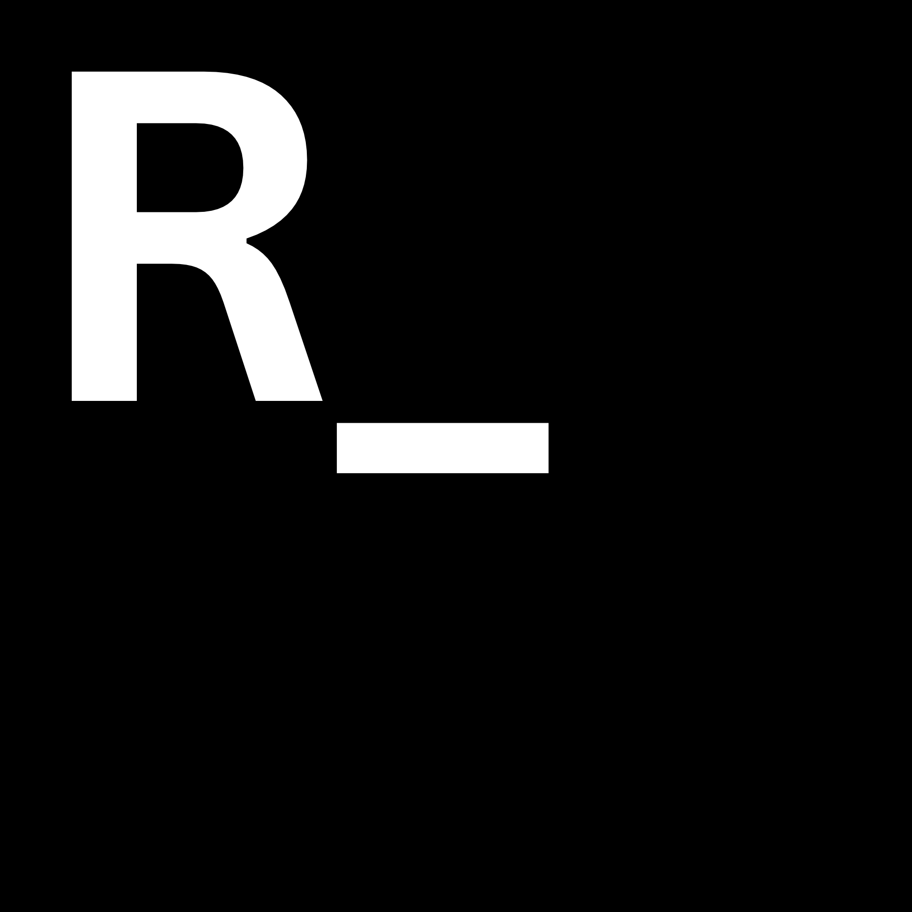

# Build & run

There are two buildable parts: the **Rust core** (`rust/`) and the **desktop
app** (`desktop/`, Tauri v2 + Svelte 5).

## Prerequisites

| Tool | Version | Notes |
| --- | --- | --- |
| Rust (rustup) | stable ≥ 1.80 | `rustup default stable` |
| Node.js | ≥ 20 | npm 10+ |
| macOS | Command Line Tools | `xcode-select --install` — **no full Xcode / CocoaPods needed** |
| Windows | MSVC Build Tools + WebView2 | WebView2 ships with Windows 11 |
| Linux | see below | WebKitGTK 4.1 |

Linux (Debian/Ubuntu):

```bash
sudo apt install build-essential pkg-config libssl-dev \
  libwebkit2gtk-4.1-dev libayatana-appindicator3-dev librsvg2-dev \
  libxdo-dev libgtk-3-dev patchelf
```

> The first build is slow (5–15 minutes) because `tauri`, `russh`, and
> `aws-lc-sys` are compiled from scratch. Later builds are incremental.

## Running in dev mode (macOS)

```bash
cd ~/Desktop/rterm/desktop
npm install
npm run tauri dev
```

What happens:

1. Vite serves the UI at `http://localhost:1420`.
2. Cargo compiles `src-tauri` (crate `rterm-app`), which path-depends on
   `../rust/crates/rterm-core`.
3. The Tauri window opens. Edit a Svelte file → hot reload; edit Rust →
   automatic rebuild then restart.

If port 1420 is taken by another process, Vite fails to start; close that
process (`lsof -i :1420`) or change `devUrl` + `server.port` in `vite.config.js`
and `src-tauri/tauri.conf.json`.

## Building the app

```bash
cd ~/Desktop/rterm/desktop
npm run tauri build
```

Output:

- macOS: `desktop/src-tauri/target/release/bundle/macos/rterm.app`
  and `…/dmg/rterm_0.1.0_<arch>.dmg`
- Windows: `…\bundle\msi\rterm_0.1.0_x64_en-US.msi`
- Linux: `…/bundle/deb/*.deb`, `…/bundle/appimage/*.AppImage`

Cross-OS bundles cannot be produced from one machine: Tauri uses the native
toolchain and bundler. Use a CI matrix (GitHub Actions) for all three.

### macOS signing (optional)

```bash
export APPLE_SIGNING_IDENTITY="Developer ID Application: Name (TEAMID)"
export APPLE_ID="you@example.com"
export APPLE_PASSWORD="app-specific-password"
export APPLE_TEAM_ID="TEAMID"
npm run tauri build
```

Without a certificate the `.app` still runs for personal use; other users must
right-click → Open (Gatekeeper) or `xattr -dr com.apple.quarantine`.

### Icons



The canonical artwork is `desktop/static/app-icon.png` (copied from
`~/Downloads/RuTerm_.png`). Generated bundle icons are in
`desktop/src-tauri/icons/`. To regenerate the full set from this artwork:

```bash
cd ~/Desktop/rterm/desktop
npm run tauri icon static/app-icon.png
```

## Rust core only

```bash
cd ~/Desktop/rterm/rust
cargo test --workspace          # unit tests for model/crypto/bridge
cargo build -p rterm-cli        # terminal harness
```

CLI (to exercise the engine without the UI):

```bash
cd ~/Desktop/rterm/rust
cargo run -p rterm-cli -- shell --host 127.0.0.1 --port 2222 --user $USER --password secret
cargo run -p rterm-cli -- exec  --host 127.0.0.1 --port 2222 --user $USER --identity ~/.ssh/id_ed25519 -- uname -a
cargo run -p rterm-cli -- keygen --out /tmp/rterm-key
```

## Build layout

```
desktop/
├─ package.json           scripts: dev, build, tauri
├─ vite.config.js         port 1420, sveltekit plugin
├─ src/                   UI
└─ src-tauri/
   ├─ Cargo.toml          crate rterm-app
   ├─ tauri.conf.json     window, identifier app.rterm, bundle
   ├─ capabilities/       plugin permissions (default: core)
   └─ src/                main.rs, lib.rs, commands.rs, state.rs, secrets.rs, store.rs
```

`desktop/src-tauri` is its own Cargo workspace; it pulls in
`rust/crates/rterm-core` via a path dependency, so core changes take effect
immediately.

## User data

| Platform | Location |
| --- | --- |
| macOS | `~/Library/Application Support/app.rterm/` |
| Windows | `%APPDATA%\app.rterm\` |
| Linux | `~/.local/share/app.rterm/` |

Contents: `vault.json`, `vault.json.bak`, `settings.json`. The keychain stores
`vault-key`, `sync-refresh`, `account`.

Deleting that folder = a full reset (the bridge-side vault remains; sign in
again and sync to re-download it).

## Common problems

| Symptom | Cause / fix |
| --- | --- |
| `failed to load manifest … rterm-app` | `desktop/src-tauri` was opened as part of the `rust/` workspace; run cargo from the right directory |
| `xcrun: error: invalid active developer path` | `xcode-select --install` |
| `error: linker cc not found` (Linux) | `build-essential` |
| `webkit2gtk-4.0 not found` | you need WebKitGTK **4.1** (Tauri v2) |
| Blank window | check the Vite console; usually an import error in Svelte |
| `npm run tauri dev` fails at `beforeDevCommand` | `npm install` hasn't been run |
| Google sign-in: `redirect_uri_mismatch` | the client is not a *Desktop app* — see `GOOGLE_OAUTH.md` |
| Slow build / OOM | `cargo build -j 2`, or cut down to release builds |

## Releasing (GitHub Actions)

The repository ships a `.github/workflows/release.yml` that builds all three
installers from a version tag and uploads them to a **draft** GitHub Release:

```bash
git tag v0.1.0
git push origin v0.1.0
```

Produced artifacts:

| Platform | Artifact |
| --- | --- |
| macOS | `RuTerm_<version>_<arch>.dmg` (`.app` inside) |
| Windows | `RuTerm_<version>_x64-setup.exe` (NSIS) + `…_x64_en-US.msi` |
| Linux | `RuTerm_<version>_amd64.deb` + `.AppImage` |

Cross-compilation is not supported, which is why the release matrix runs
`macos-latest`, `windows-latest` and `ubuntu-22.04` (`tauri-apps/tauri-action`).
Everything is **unsigned by default** so the first run succeeds; see the
commented `env` block in the workflow for the macOS signing/notarization
secrets (`APPLE_CERTIFICATE`, `APPLE_SIGNING_IDENTITY`, `APPLE_ID`,
`APPLE_PASSWORD`, `APPLE_TEAM_ID`) and the release notes in each artifact
target. Signing secrets are GitHub encrypted secrets — never in the repo,
never in the binary. A local smoke-build before tagging is still useful:
`npm run tauri build`.

## Mobile (not active yet)

The Android/iOS targets are deliberately deferred: they need the Android
SDK/NDK + `rustup target add aarch64-linux-android`, and a full Xcode for iOS.
The Tauri v2 structure is already in place
(`#[cfg_attr(mobile, tauri::mobile_entry_point)]`), but there is no mobile
config, icon set, or mobile-specific OAuth redirect yet.
